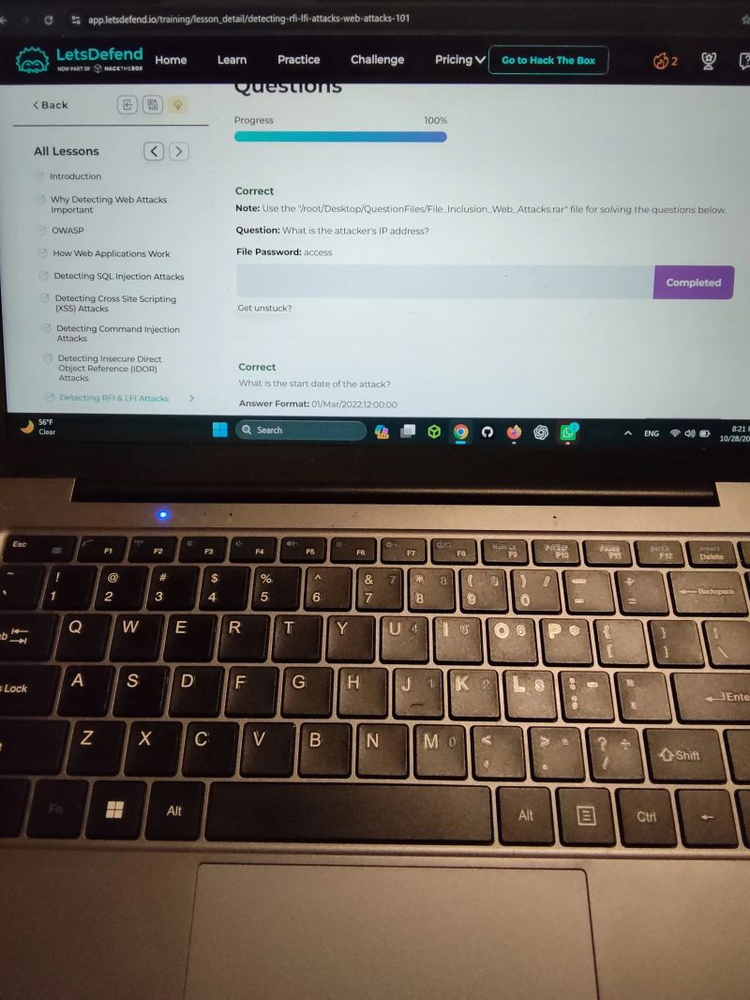

# Web Attack Investigator path

## Overview / Objective
Complete LetsDefend's Web Attack Investigator path: detect and investigate common web attacks in web server logs and decide whether each attempt actually succeeded.

## Platform & date
| Platform | Training | Completed |
|---|---|---|
| LetsDefend | Web Attack Investigator path | 28 October 2026 |

## What I did / key steps
Hands-on practice covered:
- SQL Injection
- Cross-Site Scripting (XSS)
- Command Injection
- IDOR
- LFI / RFI

I worked through **Apache access logs** to identify attack timelines, attacker activity, successful vs unsuccessful exploitation, and attack types such as **Classic SQL Injection** and **Reflected XSS**.

## Key concepts
- The attacker's first request is not always the start of the attack.
- A suspicious payload shows an **attempt**, not necessarily a successful exploit.
- `200 OK` alone does not prove exploitation succeeded.
- Response size, payload behaviour and surrounding requests need to be correlated before making a conclusion.

## Findings / outcome
- ✅ Path completed, including the Detecting SQL Injection, XSS, Command Injection, IDOR and RFI/LFI lessons.

## MITRE ATT&CK mapping
| Technique | Relevance |
|---|---|
| T1190 Exploit Public-Facing Application | SQLi, XSS, command injection, IDOR and LFI/RFI against web apps |
| T1059 Command and Scripting Interpreter | Command injection payloads |

## Lessons learned
Don't jump to conclusions from a single log entry. Build the timeline, then correlate status codes, response sizes and surrounding requests to decide whether an attack was attempted or actually successful.

---
🔗 [Original LinkedIn post](https://www.linkedin.com/feed/update/urn:li:activity:7521297226669764608/)
