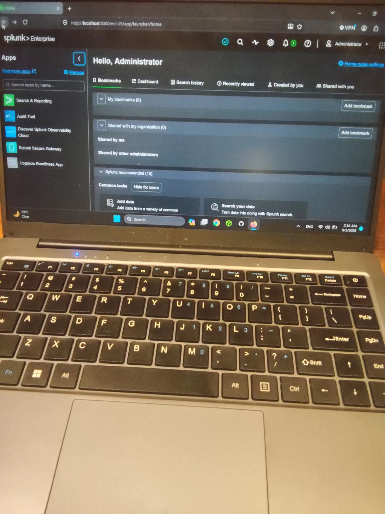

# Splunk Enterprise home-lab setup

## Overview / Objective
Run a local SIEM to practise log analysis and writing SPL queries for SOC work.

## Platform & date
| Platform | Date |
|---|---|
| Splunk Enterprise on my laptop (home lab), web UI at `localhost:8000` | 2 September 2026 |

## What I did / key steps
- Installed Splunk Enterprise locally and got it running
- Logged in to the Splunk web interface as the local administrator

## Findings / outcome
Splunk Enterprise was up and running in my home lab. This environment was later used for the [threat-hunting workflow](2026-09-06-noise-reduction-threat-hunting-workflow.md) and the [plink.exe investigation](2026-09-10-plink-event-4688-investigation.md).

## Lessons learned
A local SIEM is a great way to get comfortable with SPL and log analysis. Slowly but surely making progress.

---
🔗 [Original LinkedIn post](https://www.linkedin.com/feed/update/urn:li:activity:7501072176574361600/)
