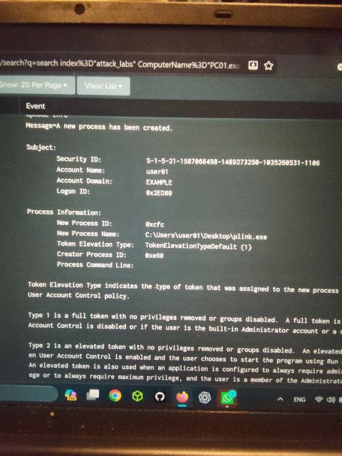
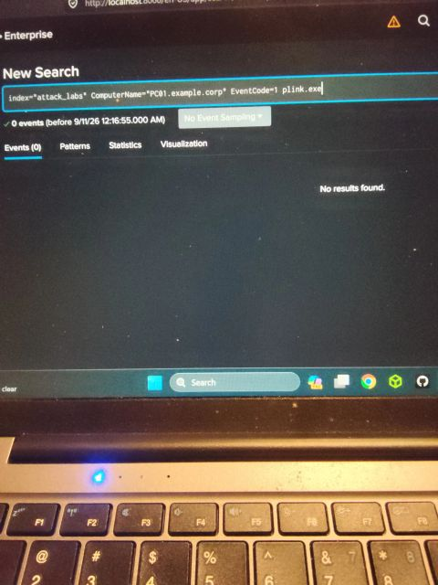

# Investigating `plink.exe` (Event ID 4688) in Splunk

## Overview / Objective
While investigating Windows Security logs in Splunk, I found that `plink.exe` had been created on a host. I wanted to understand what launched it and what it was used for.

## Platform & date
| Platform | Data | Date |
|---|---|---|
| Splunk (home lab) | Windows Security logs in index `attack_labs`, host `PC01.example.corp` | 10 September 2026 |

## What I did / key steps
1. **Found the process creation:** Windows **Event ID 4688** showed that `C:\Users\user01\Desktop\plink.exe` was created by account `user01`. The creator (parent) process ID was `0xe60` (3680). My post gives the new process ID as `0xcfcf`, while the screenshot shows `0xcfc`.

   

2. **Command line not available:** command-line auditing was disabled, so the *Process Command Line* field was empty and I couldn't see the arguments `plink.exe` was run with.
3. **Looked for the parent process:** I searched for the 4688 creation event of PID `0xe60` to see what launched `plink.exe`, but it was not in the available logs.

   

   My possible explanations:
   - the parent process started before the available log window,
   - its creation event was not recorded, or
   - the required auditing was not enabled at that time.
4. **Checked for Sysmon:** I searched for Sysmon Event ID 1, but Sysmon did not appear to be available or indexed in this lab:

   ```spl
   index="attack_labs" ComputerName="PC01.example.corp" EventCode=1 plink.exe
   ```
   This returned 0 events.

   

5. **Asked the community:** I posted on LinkedIn asking what to check next: network activity, logon events, services, scheduled tasks, PowerShell logs, or something else.

## Key concepts & queries
- **Event ID 4688:** process creation (Security log)
- **Creator Process ID:** used to trace parent-child lineage
- Effect of **disabled command-line auditing** on visibility
- **Sysmon Event ID 1:** process creation with command line, not available here
- The search shown above

## Findings / outcome
- `plink.exe` was run from `user01`'s Desktop. Its parent PID was `0xe60`, but the parent's creation event was not found.
- The command-line arguments could not be determined because of the logging configuration.
- **The investigation remained open.** The post was a request for guidance, not a conclusion.

## MITRE ATT&CK mapping
Not mapped, because the investigation was inconclusive and no technique was confirmed.

## Lessons learned
- Logging configuration decides what you can prove. Without command-line auditing or Sysmon, important evidence is missing.
- When you reach a dead end, document what you checked and what is missing, and ask for help.

---
🔗 [Original LinkedIn post](https://www.linkedin.com/feed/update/urn:li:activity:7503941449650995203/)
