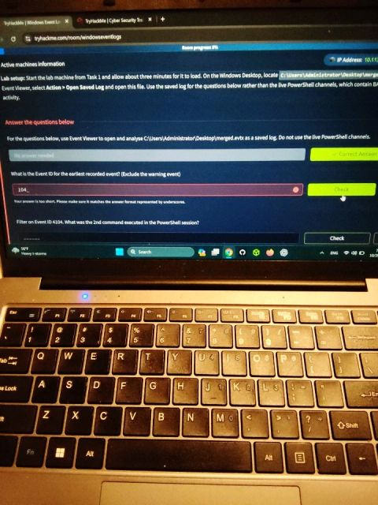
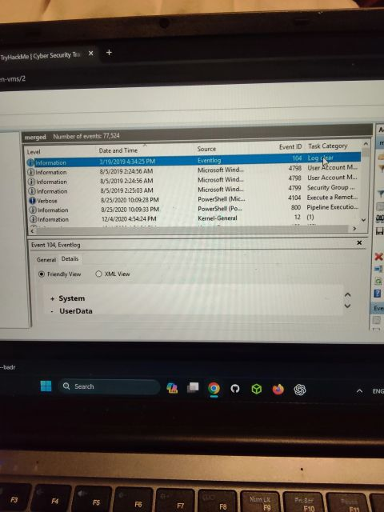

# Windows Event Logs: an ambiguous question as a troubleshooting exercise

## Overview / Objective
While working through the Windows Event Logs room, I hit an inconsistency in one of the questions. It turned into a useful exercise in validating evidence instead of chasing the expected answer.

## Platform & date
| Platform | Room | Date |
|---|---|---|
| TryHackMe | Windows Event Logs | 20 October 2026 |

## What I did / key steps
1. The task asked: *"What is the Event ID for the earliest recorded event? (Exclude the warning event)"*. The instructions said to analyse the saved `merged.evtx` log.
2. I opened `merged.evtx` in Event Viewer as a saved log and sorted the **Date and Time** column in ascending order.
3. The earliest event was:

   | Field | Value |
   |---|---|
   | Date/Time | 19 March 2019, 4:34:25 PM |
   | Level | Information |
   | Source | Eventlog |
   | Event ID | **104** |
   | Task Category | Log clear |

4. Because this event's level is Information and not Warning, Event ID 104 matched the question as written. However, the platform expects a four-digit answer, and the accepted answer is **4103**, which seems to relate to the intended PowerShell context.
5. I reported the ambiguity to TryHackMe Support for review.

## Key concepts
- Opening an `.evtx` as a **saved log** in Event Viewer, instead of using the live channels
- Sorting by Date and Time to find the earliest event
- Event ID **104**: Eventlog, "Log clear"
- Event ID **4103**: the PowerShell event the room expected

## Findings / outcome
- By the evidence in `merged.evtx`, the earliest non-warning event is Event ID 104.
- The question would be clearer if it said "earliest **PowerShell** event".
- I reported this to TryHackMe Support.

## Lessons learned
Don't just chase the expected answer. Validate what the evidence actually shows, and document the difference when they disagree.

---
🔗 [Original LinkedIn post](https://www.linkedin.com/feed/update/urn:li:activity:7518369618315415554/)
